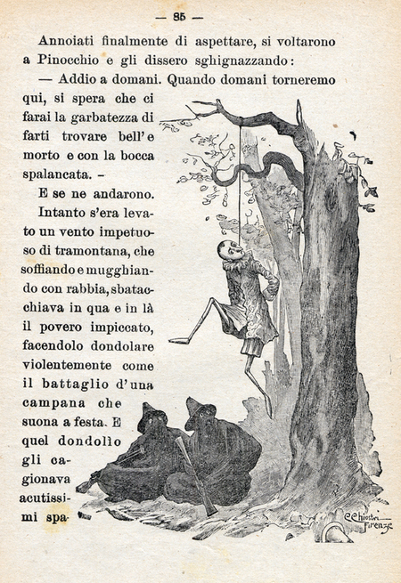

# Choose an Adventure

## Pre-digital Interactive Narrative

The history of interactive _narrative_ goes back into prehistory: Every time a child's request for a story with particular… _inclusions_ is met by an adult desperate to put the kid to sleep, a unique creation arises

> **One summer I had to tell a hundred stories that began:\
_[Nemo](https://encrypted-tbn0.gstatic.com/images?q=tbn:ANd9GcTIUgVCVTL4WBiAixPaBL8ghPQMHHw5QC_Gir2yF2qeFtFezn51kkMVLNtb&s=10) and [Ka](https://encrypted-tbn0.gstatic.com/images?q=tbn:ANd9GcRy1FSkO9FmkbTgr1rUisGGGtR3vPHaSi4Q469pYQ3B2o2uxQNgGEbOznM&s=10) were friends…_**

This little girl loved and pitied the one and, I think, was attracted to and feared the other. She needed to reconcile them, somehow

One night I began: "Nemo and Ka were friends and they used to _ride a white stallion across the baking desert…_" And when I found this was acceptable, well, things got a lot easier!

## Pre-digital Interactive Text

Interactive _writing_ has been around a while as well:

When [Carlo Collodi](https://www.britannica.com/biography/C-Collodi) began his _La storia di un burattino_ (The Story of a Puppet) in the _Giornale per i bambini_ (Children's Journal) in that fateful July of 1881, neither he nor anyone else knew he was gifting the world with _[Pinocchio](https://i.pinimg.com/originals/d5/23/69/d5236990f34237c5f1c80620e94a0883.gif)_!

Perhaps he grew tired, or wanted to punish the brats, but he ended his tale with a hanging: 

That's right, _he killed Pinocchio!_

------

[a form that's making a big comeback](https://atmospherepress.com/serialized-fiction-episodic-storytelling/)

The story was originally published in serial form as The Story of a Puppet (Italian: La storia di un burattino) in the Giornale per i bambini between 7 July 1881 and 25 January 1883,

https://www.catholicculture.org/commentary/pinocchio/

But actual interactive _writing goes at least as far back as 1961, when Raymond Queneau,  
A Hundred Thousand Billion Poems 

